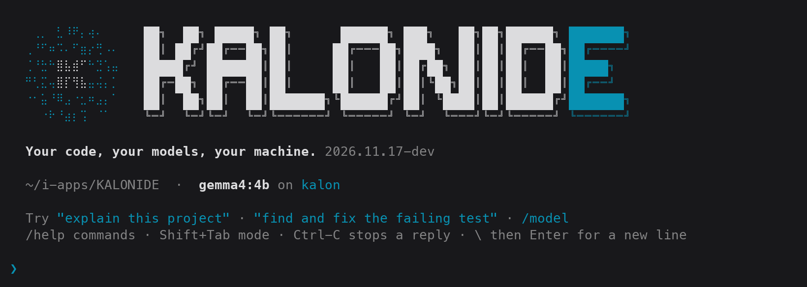

# Kalonide

Kalonide is a coding agent for your terminal. Describe what you want in
plain language, and Kalonide reads your code, makes the changes and runs your
commands and tests, asking before it does anything you haven't allowed.

It works with Kalon out of the box, and with any OpenAI-compatible model
server, including Ollama, LM Studio, OpenRouter and OpenAI.



## Install

**Homebrew** (macOS and Linux)

```bash
brew install kalonedge/tap/kalonide
```

**npm**

```bash
npm install -g kalonide
```

**Install script**

```bash
curl -fsSL https://raw.githubusercontent.com/KalonEdge/kalonide/main/install.sh | sh
```

You can also download a build from the
[releases page](https://github.com/KalonEdge/kalonide/releases). Kalonide
runs on macOS (Apple silicon and Intel) and Linux (arm64 and x86-64), and
the macOS builds are signed and notarized by Apple.

## Get started

1. Open the Kalon app and make sure its local API is on.
2. In your project folder, run:

   ```bash
   kalonide
   ```

3. Ask for what you need, for example *"add a dark mode toggle to the
   settings page"* or *"why does the login test fail?"*

There is nothing to configure. Kalonide connects to Kalon automatically and
picks the best model available for coding. To choose a different model, type
`/model`.

### Use another model server

Add a server once, and Kalonide will use it from then on:

```bash
kalonide providers add openrouter --base-url https://openrouter.ai/api/v1 --api-key-env OPENROUTER_API_KEY --use
```

Kalonide never stores API keys. It reads them from the environment variable
you name. Run `kalonide doctor` to check your setup and to find model
servers already running on your machine.

## Working with Kalonide

### Approvals

You decide how much Kalonide can do on its own. Press **Shift+Tab** to switch
modes at any time:

| Mode | What Kalonide asks you about |
|---|---|
| **Ask** (default) | Every file change, shell command and web request |
| **Auto-edit** | Shell commands and web requests; file changes go ahead |
| **Yolo** | Only commands that could destroy data |

Before any file is changed you see the exact diff, and before any command
runs you see the exact command. If you change your mind, `/undo` reverts the
file changes from your last request, and `/rewind` takes your files and the conversation back to an
earlier point.

### Keyboard

| Key | Action |
|---|---|
| Enter | Send |
| Alt+Enter, or `\` then Enter | New line |
| ↑ ↓ | Previous prompts |
| Tab | Complete a command |
| Shift+Tab | Switch approval mode |
| Ctrl+C | Stop the current reply; press twice on an empty line to quit |
| `!` + command | Run a shell command yourself |

### Commands

Type `/` to see them all. The ones you'll use most:

| Command | What it does |
|---|---|
| `/model` | Choose a model |
| `/new` | Start a fresh conversation |
| `/undo`, `/rewind` | Revert changes |
| `/help` | All commands and keys |
| `/resume` | Continue an earlier session |
| `/context` | See how much of the model's memory is in use |
| `/compact` | Summarize the conversation to free up room |
| `/init` | Create a `KALONIDE.md` guide for this project |
| `/doctor` | Check your setup |

### Give Kalonide context

- **`KALONIDE.md`** in your project tells Kalonide how the project works:
  how to build it, its conventions, what to avoid. Run `kalonide init` to
  create one. Kalonide also reads `AGENTS.md`.
- **Memories.** Kalonide can remember facts about a project (in Ask mode,
  it checks with you first). They're kept in `.kalonide/memory/` in your project, or in
  `~/.config/kalonide/memory/` for ones that apply everywhere.
- **Images.** Attach a screenshot with `/image` when you're using a vision
  model.

The first time you open a folder, Kalonide asks whether you trust it. Notes,
memories, commands and skills from that folder are used only after you say
yes.

## Scripts and CI

`kalonide exec` runs a single request without the interactive shell:

```bash
kalonide exec "fix the failing test"
```

Nobody is there to approve changes, so by default Kalonide only reads. Add
`--auto-edit` to let it edit files, or `--yolo` to also let it run commands.
Commands that could destroy data are always refused.

| Option | Purpose |
|---|---|
| `-o json` / `-o stream-json` | Machine-readable output |
| `-f prompt.md` | Read the request from a file (or pipe it on stdin) |
| `--resume` | Continue the latest session |
| `--self-check` | Run the project's tests before finishing, and fix failures |

Exit codes: `0` done, `1` error, `2` invalid usage, `3` turn limit reached,
`130` cancelled.

## Safety and privacy

- **Your files stay in scope.** Kalonide works inside the project folder,
  plus any folders you add with `--add-dir`. Symbolic links can't be used to
  reach outside it.
- **Destructive commands need you.** Recursive deletes, force pushes, hard
  resets, `sudo` and similar commands always ask, in every mode, even when
  they're quoted or written with a full path.
- **Sandboxed commands on macOS.** In auto-edit and yolo modes, the commands
  Kalonide runs can write only to your project, temporary folders and build
  caches, and can reach only your own machine. Your Git history and hooks
  are protected. On Linux, approvals are the safeguard. Run `/sandbox` to see
  the current state.
- **Secrets stay secret.** API keys and tokens are hidden from command
  output, and Kalonide never writes your keys to disk.
- **You choose where your code goes.** Kalonide sends your code only to the
  model server you choose; with Kalon, nothing leaves your machine. Sessions
  are saved locally, and `kalonide sessions audit <id>` lists every action
  taken in one.

## Extend Kalonide

- **MCP servers** add outside tools, such as a browser, a database or your
  issue tracker:

  ```bash
  kalonide mcp add playwright -- npx -y @playwright/mcp
  ```

  New tools ask before they run, unless you approve them.
- **Custom commands.** Put a Markdown file in `.kalonide/commands/` and it
  becomes a slash command. For example, `review.md` becomes `/review`.
- **Skills.** Put instructions in `.kalonide/skills/<name>/SKILL.md`, and
  Kalonide uses them when they're relevant.
- **Hooks** run your own scripts around Kalonide's work, such as formatting
  every file it edits. Run `kalonide hooks --help` for details.
- **Use Kalonide's tools elsewhere.** `kalonide serve --mcp` offers them to
  other MCP apps, and `kalonide acp` connects to editors such as Zed
  (experimental).

Commands and skills in `~/.config/kalonide/` are available in every project.

## Settings

Settings live in `~/.config/kalonide/settings.json`. Run `kalonide config`
to see them, and `kalonide config set <key> <value>` to change one. These
environment variables override them:

| Variable | Sets |
|---|---|
| `KALONIDE_PROVIDER` | Provider to use |
| `KALONIDE_MODEL` | Model to use |
| `KALONIDE_BASE_URL` | Server address |
| `KALONIDE_API_KEY` | API key |
| `KALONIDE_PERMISSION_MODE` | `ask`, `auto-edit` or `yolo` |
| `KALONIDE_HOME` | Settings folder |
| `NO_COLOR` | Turn off colors |

Run `kalonide --help` for the full list of commands and options.

## Build from source

You need Go 1.25 or later.

```bash
git clone https://github.com/KalonEdge/kalonide.git
cd kalonide
make build
```

`make test` runs the test suite. Kalonide has a single dependency outside
the Go standard library, `golang.org/x/sys`.

## License

MIT. See [LICENSE](LICENSE).
